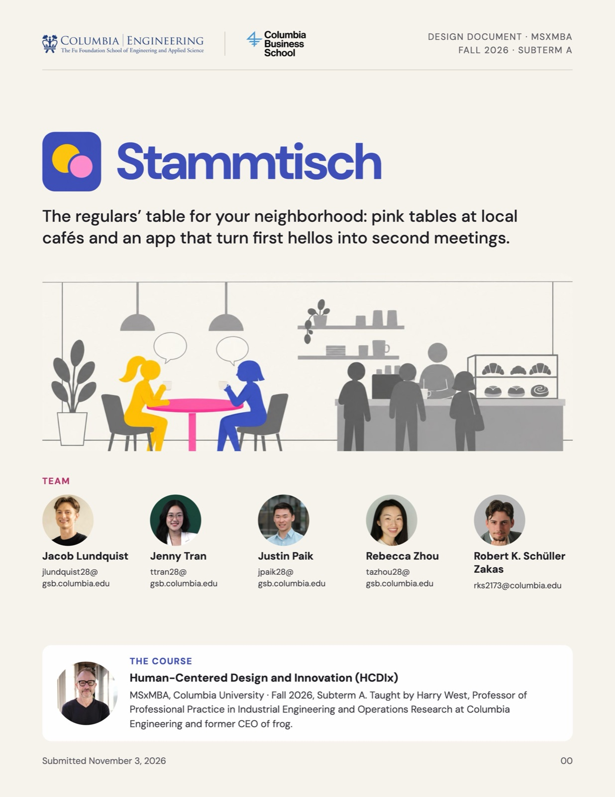

##### Links

- [Design document (PDF)](/files/Stammtisch-Design-Document.pdf)

---

<small>Team design document for Human-Centered Design and Innovation (HCDIx), Columbia MSxMBA, Fall 2026, Subterm A.</small>
